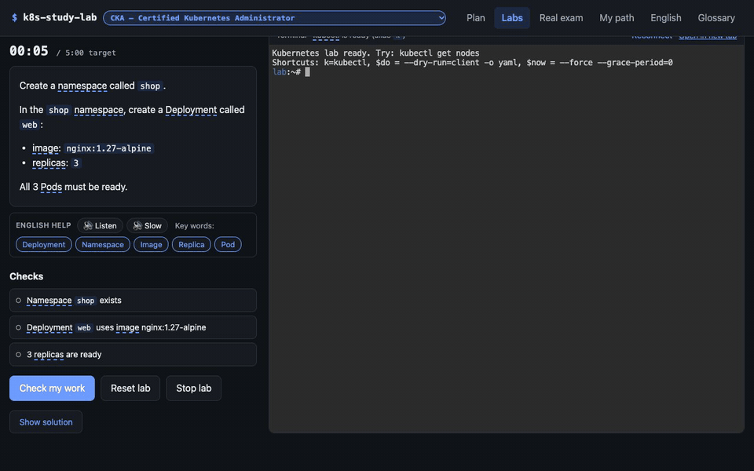
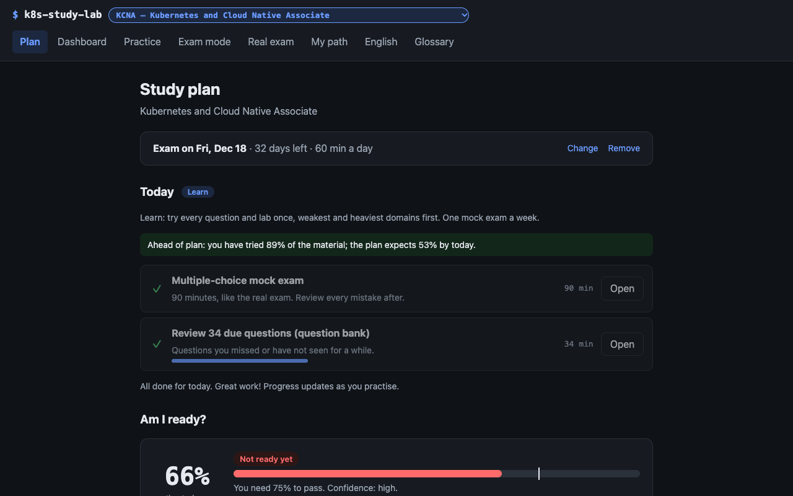
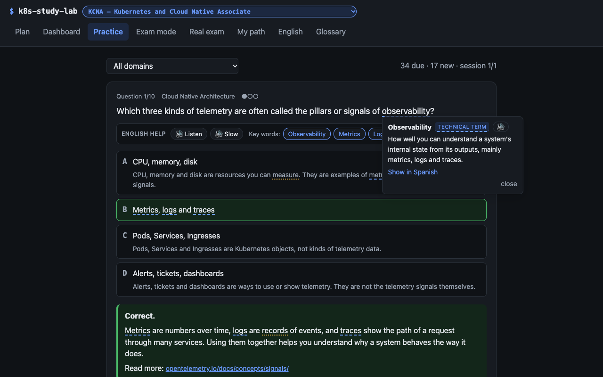
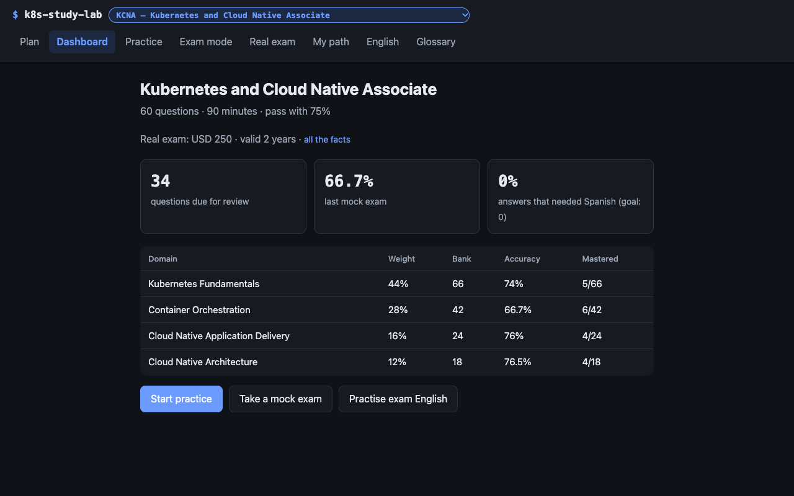
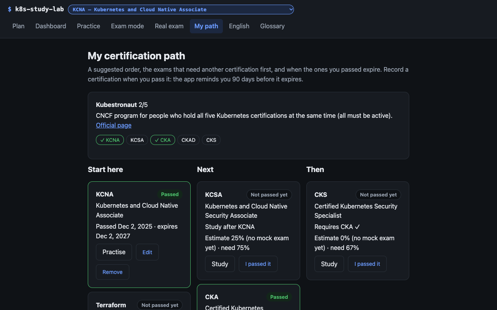
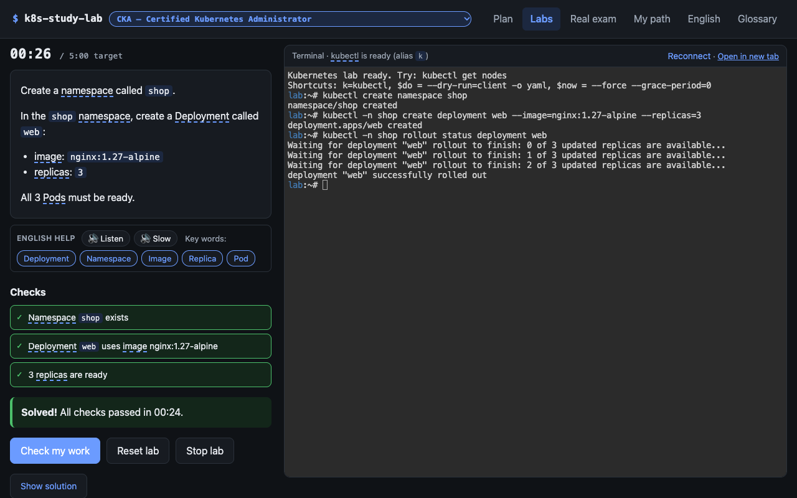
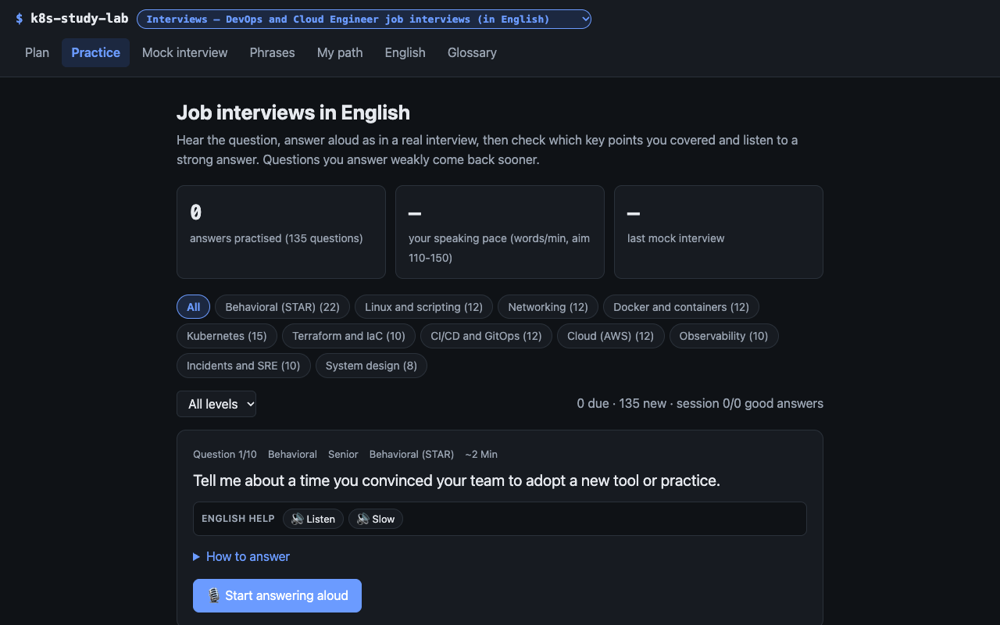

# k8s-study-lab

[](https://github.com/sotostereo-blip/k8s-study-lab/actions/workflows/ci.yml)

A free, local study environment for **Cloud Engineer / DevOps certifications**: practice questions,
mock exams and **real hands-on labs in the browser** (Kubernetes clusters, Linux servers, Docker, Gitea
Actions, Prometheus, Argo, Terraform and AWS on LocalStack), plus DevOps **job interviews in English**.
Built to practise **the exam content and technical English at the same time**.

Everything runs on your machine with Docker. No account, no cloud costs, your progress stays in a local file.



| Certification | Multiple choice | Hands-on labs (terminal in the browser) |
|---|---|---|
| **KCNA** — Kubernetes and Cloud Native Associate | 150 questions | — |
| **KCSA** — Kubernetes and Cloud Native Security Associate | 120 questions | — |
| **CKA** — Certified Kubernetes Administrator | — | 38 tasks + mock exam |
| **CKAD** — Certified Kubernetes Application Developer | — | 27 tasks + mock exam |
| **CKS** — Certified Kubernetes Security Specialist | — | 24 tasks + mock exam |
| **Terraform Associate (004)** — HashiCorp | 152 questions | 17 tasks (Terraform + LocalStack) |
| **LFCS** — Linux Foundation Certified System Administrator | 80 concept questions | 33 tasks + mock exam (Ubuntu servers with systemd, LVM, swap) |
| **DCA** — Docker Certified Associate | 120 questions | 23 tasks + mock exam (Docker Engine, Swarm, registry) |
| **GH-200** — GitHub Actions | 100 questions | 19 tasks + mock exam (Gitea Actions, GitHub compatible) |
| **CAPA** — Certified Argo Project Associate | 100 questions | 16 tasks + mock exam (Argo CD, Rollouts, Workflows, Events) |
| **PCA** — Prometheus Certified Associate | 100 questions | 19 tasks + mock exam (Prometheus, Alertmanager, exporters) |
| **AWS SAA-C03** — Solutions Architect Associate | 150 questions | 12 tasks + mock exam (AWS CLI + LocalStack) |
| **DevOps job interviews in English** | 135 interview questions | mock interviews, useful phrases |

## Quick start

You need **Docker Desktop** (or Docker Engine + Compose 2.24+ on Linux), about 4 GB of memory for Docker
and free ports 5173, 8000 and 7681.

```bash
git clone https://github.com/sotostereo-blip/k8s-study-lab.git
cd k8s-study-lab
cp .env.example .env          # optional settings (ports, AI key)
docker compose up -d --build
```

Open **http://localhost:5173** and choose a certification at the top of the page.
The first build takes a few minutes. Each kind of lab gets its images the first time you open one:
ready-made images are downloaded from GitHub (`ghcr.io`) when published, otherwise they are built on your
machine (`sh scripts/build_labs.sh` gets them all ahead of time, ~15 GB).

Stop with `docker compose down`; update with `git pull && docker compose up -d --build`.
Your progress is kept in `data/progress.db`; **My path → Your data** downloads it as a backup or imports it
on another computer.

### Install it with an AI assistant

[INSTALL.md](INSTALL.md) is a step-by-step guide written so that an AI coding assistant
(Claude Code, Codex, Cursor, Copilot…) can install and check everything on your machine.
Open a terminal where you want the project and give your assistant this prompt:

```text
Install and start the project https://github.com/sotostereo-blip/k8s-study-lab on this machine.
Clone it, then follow INSTALL.md step by step: check each "Expected" result before the next step,
and use its Troubleshooting table if something fails. Do not change the application code.
When it works, give me the URL to open.
```

Requirements, Windows (WSL 2) and Linux notes, a lab smoke test and troubleshooting are all in
[INSTALL.md](INSTALL.md).

## What you can do

| Study plan and readiness | Practice with English help |
|---|---|
|  |  |
| **Progress per domain** | **Certification path** |
|  |  |
| **Hands-on labs** | **Job interviews in English** |
|  |  |

- **Plan**: set your exam date and the time you have each day. The app gives you the work for today
  (reviews due, new questions focused on your weakest and heaviest domains, labs to solve, and mock exams
  that get more frequent as the exam gets close) and a road map: *Learn* → *Practice* (last 3 weeks) →
  *Final week* → *Rest*. It also tells you if you are ahead of or behind plan.
- **My path**: a map of the certifications in a suggested order (*Start here → Next → Then*), the exams
  that need another one first (the CKS needs a passed CKA), and Kubestronaut progress. Record a
  certification when you pass it: the app shows when it expires and reminds you on every page 90 days
  before (a CKS passed on or after June 18, 2026 extends your CKA, as the Linux Foundation rule says).
- **Mock exam history** (Plan tab): your mock exam scores over time against the passing line, and per
  official domain the first result, the average of the last 3 and the change, so you see what improved.
- **Am I ready?** An estimated exam score: your last 3 mock exams (60%) mixed with your practice (40%),
  following the official domain weights. It compares the estimate with the passing score and says
  *Not ready yet*, *Almost ready* or *Ready* (two mock exams in a row 5 points above the passing score).
  For a hands-on exam (CKA, CKAD, CKS, LFCS) the labs count most.

- **Practice** with spaced repetition (Leitner boxes): questions you miss come back sooner.
  When you pick a wrong option, the app tells you **why that option is wrong**, then explains the right answer. With an API key, *Explain more (AI)* goes deeper.
- **Mock exams** that follow the official domain weights, with a timer, *Flag for review*, and a
  per-domain report that links your weak domains to practice. Options to make them feel like the real exam:
  - **Real exam conditions**: no glossary, translation or listening (the real exam is only in English).
  - **DOMC** (Docker DCA): about 3 of every 4 questions show their options one at a time; you answer
    YES or NO to each, cannot go back, and the question can end early, like the real DCA exam.
  - **ESL +30 minutes** (AWS SAA): the extra time AWS gives when English is not your first language
    (you must request it in your AWS Certification account before booking).
- **Hands-on labs**: choose a task and a real environment starts in Docker with a terminal
  **inside the browser** — a Kubernetes 1.37 cluster (k3s; 1 node, 2 nodes, with API audit
  logging for CKS, or with Argo CD), Ubuntu servers with systemd, a Docker Engine, Gitea with
  Actions, a Prometheus stack, or Terraform / the AWS CLI with LocalStack, a free local AWS emulator. Solve it,
  press *Check my work*, and the app inspects the real state. Every task was verified on a real
  environment (fails before, passes after the solution). See [labs/README.md](labs/README.md).
- **Lab mock exams** (CKA, CKAD, CKS, LFCS, DCA, GH-200, CAPA, PCA, AWS): 5, 10 or 15 tasks in one lab environment with one countdown,
  graded at the end with partial credit, plus a full review with solutions. For CKA, CKAD, CKS and LFCS the
  mock exam lists **what the real exam allows** (only kubernetes.io/docs and a few other sites; LFCS: no
  websites, only man pages and /usr/share), has a notes box, and can hide the English helpers.
- **Job interviews in English** (DevOps / Cloud Engineer): hear the question, answer aloud
  (speech to text in Chrome, or type), tick the key points you covered, listen to a model
  answer and the likely follow-ups. Timed **mock interviews** open with a behavioral (STAR)
  question and mix topics; the app tracks your speaking pace (words per minute) and filler
  words. A **Phrases** tab has spoken English for interviews (buying time, trade-offs,
  admitting you don't know…).
  **Optional AI feedback** (Claude): after an answer, press *Get AI feedback* to see which key points
  you covered, what to improve, corrections to your English and an improved version of your own
  answer. It is off unless the backend has an `ANTHROPIC_API_KEY`; everything else works without it.
- **Built-in English support**, everywhere (questions, labs and mock exams):
  - technical terms (blue, dashed) and everyday exam words such as *ensure*, *by default*
    or *eventually* (amber, dotted) are clickable: simple English definition, example,
    pronunciation, and Spanish only on demand;
  - an **English help** bar under every question and task with its key words and a
    🔊 *Listen* / *Slow* button (US English voice of your browser);
  - an **English** tab to practise those words with spaced repetition; the words you
    looked up most come first;
  - the app counts lookups, translations and listens, so you can watch your need for
    Spanish go down.

## The real exams (checked November 2026)

| Exam | Questions | Time | Price (USD) | Prerequisite | Valid |
|---|---|---|---|---|---|
| KCNA | ~60 multiple choice | 90 min | 250, 1 free retake | — | 2 years |
| KCSA | ~60 multiple choice | 90 min | 250, 1 free retake | — | 2 years |
| CKA | 15-20 hands-on tasks | 2 h | 445, 1 free retake | — | 2 years |
| CKAD | 15-20 hands-on tasks | 2 h | 445, 1 free retake | — | 2 years |
| CKS | 15-20 hands-on tasks | 2 h | 445, 1 free retake | passed CKA | 2 years |
| Terraform Associate (004) | ~57 multiple choice | 1 h | 70.50 + tax, no retake | — | 2 years |
| LFCS | ~17-20 hands-on tasks | 2 h | 445, 1 free retake | — | 2 years |
| DCA | 55 (13 MC + 42 DOMC) | 90 min | 199, no retake | — | 2 years |
| GH-200 | ~60-75 multiple choice | 100 min | by country (~99 in the US) | — | 2 years |
| CAPA | ~60 multiple choice | 90 min | 250, 1 free retake | — | 2 years |
| PCA | ~60 multiple choice | 90 min | 250, 1 free retake | — | 2 years |
| AWS SAA-C03 | 65 multiple choice | 130 min | 150, no retake | — | 3 years |

"~" means the provider does not publish the number. More detail (passing score, renewal, what the price
includes, official link) is in the **Real exam** tab of each certification and in `content/certifications.yaml`.
Prices change: check the official page before you pay.

## Settings (`.env`)

All optional; the app works without a `.env` file.

| Variable | Default | What it does |
|---|---|---|
| `APP_PORT` | `5173` | host port of the web app |
| `API_PORT` | `8000` | host port of the API (docs at `/docs`) |
| `LAB_IMAGE_REGISTRY` | `ghcr.io/sotostereo-blip/k8s-study-lab` | where ready-made lab images are downloaded from; empty = build them locally |
| `ANTHROPIC_API_KEY` | empty | turns on the optional AI feedback (see below) |
| `LLM_MODEL` | `claude-opus-5-5` | Claude model for the AI feedback |
| `AI_FEEDBACK` | on with a key | `0` turns the AI feedback off |

## Optional: AI help (Claude)

Two buttons appear when the backend has an Anthropic API key; everything else works without one:

- **Explain more (AI)** under a practice question, after you check it: the idea behind the question, why
  the right answer is right, why your choice was tempting, a concrete example, one thing to remember and a
  question to check yourself. You can also ask your own question about it (in English or Spanish).
- **Get AI feedback** on interview answers (see above).

Put your Anthropic API key in `.env` (never commit it):

```bash
ANTHROPIC_API_KEY=sk-ant-...
# LLM_MODEL=claude-opus-5-5   # optional, the default
# AI_FEEDBACK=0              # turn it off again
```

Only the question (with its answer, explanation and docs links) and what you wrote or chose are sent,
and only when you press an AI button. Nothing is stored.
Each request is billed to your Anthropic account (a few cents at most).

## Keeping the exam facts fresh

Prices, question counts and rules change. Every certification records the month its facts were
checked (`official.checked`); after 6 months the **Real exam** tab says they may be out of date.

```bash
python scripts/check_facts.py            # which facts are older than 6 months
python scripts/check_facts.py --online   # also open each official page and look for price and minutes
```

## Development

```bash
# backend (Python 3.12+)
cd backend
python3 -m venv .venv && source .venv/bin/activate
pip install -r requirements.txt
uvicorn app.main:app --reload

# frontend (Node 22+, another terminal)
cd frontend
npm install
npm run dev
```

Checks: `python scripts/validate_content.py` and `cd backend && pytest -q` (CI runs both on every push).
Lab tasks are verified on real environments with `python scripts/verify_labs.py` (see [labs/README.md](labs/README.md)).

```
backend/     FastAPI API, SQLite progress, spaced repetition, lab manager
frontend/    React (Vite) UI
content/     Questions, glossary, interview questions and lab tasks as YAML  ← contributions welcome
labs/        Docker Compose lab environments (k3s, Ubuntu, Docker, Gitea, Prometheus, LocalStack…)
scripts/     content validator, lab verifier, lab images, exam-facts check, README screenshots
docs/        CONTENT_FORMAT.md, ROADMAP.md
```

## Contributing questions and labs

See [docs/CONTENT_FORMAT.md](docs/CONTENT_FORMAT.md), then run the validator and the tests.

**All questions must be original**, based on the public curriculum and the official docs.
Certification exams are covered by confidentiality agreements; never add questions remembered from a real exam.

Roadmap: [docs/ROADMAP.md](docs/ROADMAP.md).

## En español

Entorno de estudio local y gratuito para certificaciones Cloud / DevOps (KCNA, CKA, CKAD, CKS, LFCS,
Terraform, Docker DCA, GitHub Actions, Argo, Prometheus, AWS SAA) con preguntas, simulacros, labs reales en
el navegador y entrevistas de trabajo. El contenido está en inglés simple, con ayuda en español a pedido.
Para instalarlo necesitas Docker Desktop y ejecutar los comandos de **Quick start**, o pedirle a tu
asistente de IA que siga [INSTALL.md](INSTALL.md) (puedes pegarle el prompt de arriba).

## License

Code: [MIT](LICENSE). Content in `content/`: [CC BY-SA 4.0](content/LICENSE).

This project is not affiliated with the CNCF, the Linux Foundation, HashiCorp, Docker, GitHub, AWS or
any exam provider. Kubernetes is a registered trademark of The Linux Foundation.
